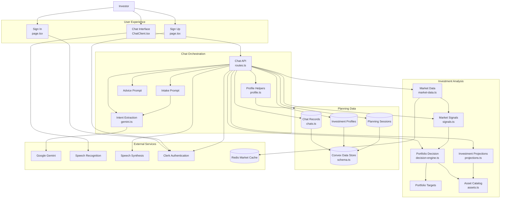

### 🤖 AI Investment Advisor — Full Voice-to-Voice GenAI System

- A production-oriented, voice-enabled AI Investment Advisor that listens to users, understands financial goals, and responds with structured, goal-based investment guidance using real-time conversational AI.


### 🔗 GitHub: https://github.com/Abhishek-3191/AI-Investment-Advisor

### 🎥 Demo (Loom): https://www.loom.com/share/1ecfc9239cff4e03bcc524c8f4bff176

# 🤖 AI Investment Advisor

### A Voice-First, Conversational Generative AI Investment Assistant


\


**AI Investment Advisor** is a voice-first Generative AI application that helps users explore investment strategies through natural conversations.

Built with Next.js, TypeScript, and Google's Gemini API, the application understands financial goals expressed in natural language, identifies vague or incomplete requirements, asks contextual follow-up questions, and generates structured, goal-based investment guidance.

Unlike a basic LLM chatbot, the application combines conversational AI with a deterministic investment analysis layer, structured data validation, user profiles, planning sessions, and market-data caching.

\<p align="center">   \<a href="[https://www.loom.com/share/1ecfc9239cff4e03bcc524c8f4bff176](https://www.loom.com/share/1ecfc9239cff4e03bcc524c8f4bff176)">\<b>🎥 Watch Live Demo\</b>\</a>   &nbsp; | &nbsp;   \<a href="[https://github.com/Abhishek-3191/AI-Investment-Advisor](https://github.com/Abhishek-3191/AI-Investment-Advisor)">\<b>💻 Explore Source Code\</b>\</a> \</p>

---

## 📑 Table of Contents

1. [Problem Statement](#-problem-statement)
2. [Project Overview](#-project-overview)
3. [Key Features](#-key-features)
4. [System Architecture](#-system-architecture)
5. [Architecture Components](#-architecture-components)
6. [End-to-End Request Lifecycle](#-end-to-end-request-lifecycle)
7. [AI Engineering and Intent Extraction](#-ai-engineering-and-intent-extraction)
8. [Investment Analysis Engine](#-investment-analysis-engine)
9. [Data Management and Caching](#-data-management-and-caching)
10. [Authentication and Security](#-authentication-and-security)
11. [Failure Handling and Edge Cases](#-failure-handling-and-edge-cases)
12. [Engineering Decisions and Trade-offs](#-engineering-decisions-and-trade-offs)
13. [Technology Stack](#-technology-stack)
14. [Project Structure](#-project-structure)
15. [Getting Started](#-getting-started)
16. [Future Improvements](#-future-improvements)
17. [Disclaimer](#-disclaimer)

---

## 🎯 Problem Statement

Retail investors often struggle to make informed investment decisions because of several challenges:

- **Unclear financial goals:** Users may have an objective but cannot translate it into specific investment requirements.
- **Financial complexity:** Investment terminology and asset classes can be difficult for beginners to understand.
- **Generic recommendations:** Traditional information sources often provide broad suggestions without considering individual goals or risk appetite.
- **Asset comparison:** Comparing stocks, mutual funds, gold, and silver requires understanding different investment characteristics.
- **Lack of conversational guidance:** Many financial tools expect users to provide all their investment details upfront.

For example, a user might simply say:

> "I want to become rich."

This statement does not provide enough information to generate meaningful investment guidance.

A conventional chatbot might immediately produce a generic response. This application instead attempts to understand the user's actual requirements through contextual questioning.

## 💡 Project Overview

The AI Investment Advisor follows a conversational workflow that collects and validates financial information before generating investment guidance.

The system:

1. Accepts voice or text-based user input.
2. Uses Gemini to understand the user's financial intent.
3. Identifies missing, vague, or incomplete information.
4. Generates relevant follow-up questions.
5. Extracts financial requirements into structured data.
6. Validates the investment profile.
7. Processes the information through the investment analysis modules.
8. Generates structured investment guidance.
9. Delivers the response through the application's voice and chat interfaces.

### Core design principle

**LLM-driven understanding + deterministic investment logic + structured output validation.**

The LLM handles natural-language understanding and conversational interaction, while dedicated application modules handle investment analysis, profile validation, and structured data processing.

---

## ✨ Key Features

### 1. 🎙️ Voice-First Conversational Interface

The application supports voice-based interaction so users can describe their financial requirements naturally.

**Capabilities:**

- Speech-to-text for converting spoken input into text.
- Text-to-speech for delivering AI-generated responses.
- Natural conversational interaction.
- Confirmation-based handling of unclear voice inputs.
- Chat interface for viewing and continuing conversations.

**Implementation flow:**

`User Voice → Speech Recognition → Chat API → AI Processing → Response → Speech Synthesis`

The voice layer makes the application more accessible to users who are unfamiliar with financial terminology or prefer speaking over typing.

### 2. 🧠 Intelligent Financial Intent Extraction

This is one of the core AI engineering components of the project.

The application uses Gemini to interpret natural-language requests and extract relevant financial information.

For example:

**User:**
"I want to invest for my future."

The application identifies that the request is incomplete and needs additional context.

Instead of immediately generating a recommendation, it asks relevant follow-up questions.

The system aims to extract:

| Financial attribute | Purpose                                              |
| ------------------- | ---------------------------------------------------- |
| Investment amount   | Understands the available investment budget          |
| Investment duration | Identifies the investment time horizon               |
| Risk appetite       | Understands the user's tolerance for investment risk |
| Financial goal      | Determines what the user wants to achieve            |

**AI engineering concepts involved:**

- Natural-language understanding.
- Intent extraction.
- Prompt engineering.
- Contextual follow-up generation.
- Ambiguity resolution.
- Structured information extraction.
- Input validation and profile re-validation.

This creates a multi-step conversational experience instead of a simple question-and-answer chatbot.

### 3. 📋 Dynamic Investment Intake

The intent extraction component works with an intake prompt to collect the information needed for investment analysis.

The process is designed to:

- Identify which financial attributes are already available.
- Detect missing or unclear information.
- Generate follow-up questions.
- Build a more complete investment profile.
- Validate the collected profile before further processing.

This separation between intent extraction and investment guidance helps prevent the system from generating recommendations based on incomplete user information.

### 4. 📊 Multi-Asset Investment Analysis

The application includes dedicated investment analysis modules to process financial inputs and generate investment guidance.

The supported asset categories include:

- Stocks
- Mutual Funds
- Gold
- Silver

The investment analysis layer includes:

| Module                    | Responsibility                                           |
| ------------------------- | -------------------------------------------------------- |
| Market Data               | Retrieves and manages market-related data                |
| Market Signals            | Derives signals from available market information        |
| Portfolio Decision Engine | Evaluates investment profiles and asset options          |
| Investment Projections    | Generates investment projections                         |
| Portfolio Targets         | Handles portfolio target information                     |
| Asset Catalog             | Maintains asset-related information used during analysis |

The goal is to keep investment analysis separate from free-form LLM responses.

### 5. 🧮 Deterministic Decision Engine

The application uses a dedicated portfolio decision module rather than depending entirely on an LLM to determine investment allocations.

The decision engine works with:

- Validated investment profile information.
- Available market signals.
- Asset catalog information.
- Portfolio targets.

This separation helps keep investment calculations and decision logic within application-controlled modules.

**Why this matters:**

LLMs are useful for interpreting natural language and explaining results, but relying exclusively on generated text for financial calculations can lead to inconsistent outputs.

A dedicated decision layer provides a more controlled foundation for investment analysis.

### 6. 📈 Investment Projections

The investment projections module handles projection-related processing using investment inputs and asset information.

It is designed to support:

- Goal-oriented investment planning.
- Investment projection calculations.
- Portfolio planning.
- Structured presentation of projected outcomes.

### 7. 🔐 User Authentication and Protected Access

The application uses Clerk for authentication and account management.

Features include:

- User sign-up and sign-in.
- Authenticated application access.
- Protected API routes.
- Authentication checks for user-specific operations.

### 8. 💾 Persistent Planning and Conversation Data

Convex is used for server-side data handling and persistence.

The planning data layer is organized around three major categories:

| Data module                 | Responsibility                              |
| --------------------------- | ------------------------------------------- |
| Chat Records (`chats.ts`)   | Stores and retrieves conversation records   |
| Investment Profiles         | Manages user investment profile information |
| Planning Sessions           | Maintains investment planning session data  |
| Convex Schema (`schema.ts`) | Defines the application's data structure    |

This separation helps organize conversational history, investment information, and planning sessions independently.

### 9. ⚡ Redis Market-Data Caching

The application includes a Redis-based market cache.

The caching layer is used by the market-data module to avoid repeatedly fetching the same data when a cached result is available.

**Caching approach:**

- Cache market-related data.
- Reuse available cached values.
- Apply TTL-based expiration.
- Refresh data when the cached entry expires or is unavailable.

This helps reduce redundant external data requests and improves the efficiency of market-data access.

---

## 🏗️ System Architecture

The application follows a modular client-server architecture with centralized chat orchestration.

The architecture is organized into five major layers:

1. User Experience Layer
2. Chat Orchestration Layer
3. Investment Analysis Layer
4. Planning and Persistence Layer
5. External Services and Caching Layer

### High-Level Architecture Diagram



*The diagram represents the major architectural components and their logical relationships. Individual request paths may vary depending on the operation.*

---

## 🧩 Architecture Components

### 1. User Experience Layer

**Primary components:**

- `ChatClient.tsx`
- Sign-in page
- Sign-up page

This layer handles user interaction.

The chat interface acts as the entry point for investment-related conversations. Users can submit financial questions, provide additional information, and receive responses.

Clerk handles the authentication experience through the sign-in and sign-up interfaces.

### 2. Chat Orchestration Layer

**Primary components:**

- Chat API (`routes.ts`)
- Intent Extraction (`gemini.ts`)
- Intake Prompt
- Advice Prompt
- Profile Helpers (`profile.ts`)

This is the central application coordination layer.

The Chat API receives user messages and coordinates the relevant processing modules.

**Responsibilities:**

- Process incoming chat requests.
- Invoke intent extraction.
- Coordinate intake and advice prompts.
- Validate investment profile information.
- Request investment guidance.
- Read and persist relevant conversation and planning data.

The separation of prompts and profile helpers keeps conversational reasoning, data validation, and request handling logically organized.

### 3. Investment Analysis Layer

**Primary components:**

- `market-data.ts`
- `signals.ts`
- `decision-engine.ts`
- `projections.ts`
- `assets.ts`

This layer handles investment-related processing.

Its purpose is to separate market-data access, signal derivation, portfolio decisions, and investment projections into dedicated modules.

**Logical processing flow:**

`Market Data → Market Signals → Portfolio Decision Engine → Portfolio Targets / Asset Catalog → Investment Projections`

This modular approach makes investment-related responsibilities easier to understand, maintain, and extend independently.

### 4. Planning and Persistence Layer

**Primary components:**

- Chat Records (`chats.ts`)
- Investment Profiles
- Planning Sessions
- Convex Schema (`schema.ts`)

This layer handles the application's persistent planning information.

It separates:

- Conversation history.
- User investment profiles.
- Planning session information.

Convex provides the server-side data layer, while the schema defines the structure of the application's stored data.

### 5. External Services and Caching Layer

The application integrates multiple external services.

| Service            | Purpose                                                                         |
| ------------------ | ------------------------------------------------------------------------------- |
| Google Gemini      | Natural-language understanding, intent extraction, and conversational reasoning |
| Speech Recognition | Converts spoken user input into text                                            |
| Speech Synthesis   | Converts generated responses into speech                                        |
| Clerk              | Authentication and user access management                                       |
| Redis              | Market-data caching                                                             |
| Convex             | Persistent application data and server-side handling                            |

---

## 🔄 End-to-End Request Lifecycle

The following explains how the major components work together during an investment conversation.

### Step 1: User Authentication

The user creates an account or signs in through Clerk.

Authenticated users access the chat interface and investment-planning functionality.

### Step 2: User Sends a Message

The user submits a financial request through the chat interface.

For voice input, speech recognition converts the audio into text before it enters the chat workflow.

Example:

"I want to invest ₹10,000 every month."

### Step 3: Chat API Receives the Request

The Chat API (`routes.ts`) receives the incoming message and coordinates the conversational workflow.

It acts as the central entry point for chat processing.

### Step 4: Intent Extraction

The intent extraction module (`gemini.ts`) uses Gemini to understand the user's request.

It attempts to identify relevant financial information and determine whether the request contains enough context.

### Step 5: Intake and Profile Validation

When information is incomplete, the intake prompt helps generate contextual follow-up questions.

The profile helpers (`profile.ts`) are responsible for profile-related validation.

For example, if the user has not specified their investment duration or risk appetite, the conversation can collect those details before proceeding.

### Step 6: Investment Analysis

Once the required information is available, the investment analysis modules process the relevant information.

The analysis layer includes:

1. Market-data access.
2. Market-signal derivation.
3. Portfolio decision processing.
4. Portfolio target handling.
5. Asset catalog access.
6. Investment projections.

### Step 7: Guidance Generation

The advice prompt and Gemini-based reasoning are used to generate conversational investment guidance.

The application uses structured output and validation mechanisms to maintain controlled response formatting.

### Step 8: Data Persistence

The relevant chat records, investment profiles, and planning sessions are handled through Convex.

### Step 9: Response Delivery

The response is displayed in the chat interface.

Where voice output is used, speech synthesis converts the response into audio for the user.

---

## 🧠 AI Engineering Deep Dive

### Intent Extraction vs. Advice Generation

A key architectural decision is separating the understanding of user intent from the generation of investment guidance.

| Intent Extraction              | Advice Generation                    |
| ------------------------------ | ------------------------------------ |
| Understands the user's request | Generates investment guidance        |
| Extracts financial attributes  | Uses the collected financial context |
| Identifies missing information | Explains investment options          |
| Helps resolve ambiguity        | Produces conversational responses    |
| Supports profile completion    | Uses the advice prompt               |

This separation makes the conversational workflow more manageable and prevents every user message from being treated as a request for immediate investment recommendations.

### Handling Ambiguous Inputs

Consider this conversation:

**User:** "I want to become rich."

**AI:** "I can help you explore investment options. What amount are you considering investing?"

**User:** "Around ₹5,000 per month."

**AI:** "For how long are you planning to invest?"

**User:** "Maybe five years."

The application continues collecting the relevant context, including risk appetite and financial goals, before moving toward investment guidance.

The important part is that the system does not treat a vague initial statement as a complete investment profile.

### Why Structured Outputs Matter

Free-form LLM responses can be difficult to validate and render consistently.

The application uses structured JSON output and schema validation to make generated information easier to process.

The intended processing flow is:

`User Message → Gemini → Structured Output → Validation → Application Logic → UI`

This helps separate generated content from the application's expected data structure.

---

## ⚙️ Failure Handling and Edge Cases

The application considers several situations that can interrupt a conversational workflow.

| Scenario                      | Handling Approach              |
| ----------------------------- | ------------------------------ |
| Unclear speech recognition    | Confirmation-based follow-up   |
| Vague investment goal         | Contextual follow-up questions |
| Missing financial information | Additional intake questions    |
| Incomplete investment profile | Profile validation             |
| Invalid generated output      | Schema validation              |
| Gemini response timeout       | Timeout handling               |
| AI service errors             | Graceful fallback              |
| Authentication expiry         | Authentication recovery        |
| Malformed input               | Input validation               |

The overall objective is to avoid treating every incoming message or AI-generated response as valid application data.

---

## ⚖️ Engineering Decisions and Trade-offs

### 1. Centralized Chat Orchestration

The Chat API coordinates the conversational workflow and communicates with the required modules.

**Benefit:** Keeps frontend components simpler and centralizes request processing.

**Trade-off:** The orchestration layer carries more responsibility and needs clear separation between its underlying modules.

### 2. LLM Reasoning + Deterministic Application Logic

Gemini handles natural-language understanding and conversational responses, while dedicated application modules handle investment-related processing.

**Benefit:** Reduces reliance on unconstrained LLM-generated calculations and separates responsibilities.

**Trade-off:** Requires additional validation and coordination between AI-generated information and application logic.

### 3. Structured Outputs

AI responses are expected to follow controlled structures that can be validated before rendering.

**Benefit:** Improves consistency and makes frontend integration easier.

**Trade-off:** Requires handling incomplete or invalid generated responses.

### 4. Redis Caching

The market-data module uses Redis caching to avoid unnecessary repeated data retrieval.

**Benefit:** Reduces redundant data requests and improves data-access efficiency.

**Trade-off:** Cached information can become stale, so TTL-based expiration is important.

### 5. Stateless API Design

The API layer is designed around stateless request handling, with relevant application data managed through the persistence layer.

**Benefit:** Makes request processing easier to scale horizontally.

**Trade-off:** The backend must coordinate persistent conversation and planning information correctly across requests.

---

## 🛠️ Technology Stack

| Category                    | Technologies                                                          |
| --------------------------- | --------------------------------------------------------------------- |
| Frontend                    | Next.js 14, React, TypeScript, Tailwind CSS                           |
| Backend                     | Next.js API Routes                                                    |
| Database / Server-side Data | Convex                                                                |
| Authentication              | Clerk                                                                 |
| LLM                         | Google Gemini API                                                     |
| Caching                     | Redis                                                                 |
| Voice Interaction           | Speech Recognition, Speech Synthesis                                  |
| AI Techniques               | Intent Extraction, Prompt Engineering, Structured Outputs, Guardrails |
| Development                 | Git, GitHub                                                           |

---

## 📁 Project Structure

The following is a logical overview of the modules represented in the architecture:

```text
AI-Investment-Advisor/
│
├── app/
│   ├── api/
│   │   └── chat/
│   │       └── routes.ts
│   │
│   ├── ChatClient.tsx
│   ├── page.tsx
│   └── ...
│
├── components/
│   └── ...
│
├── lib/
│   ├── gemini.ts
│   ├── profile.ts
│   ├── market-data.ts
│   ├── signals.ts
│   ├── decision-engine.ts
│   ├── projections.ts
│   ├── assets.ts
│   └── redis.ts
│
├── convex/
│   ├── chats.ts
│   ├── schema.ts
│   └── ...
│
├── public/
│
├── .env.local
├── package.json
└── README.md
```

*This is a conceptual structure based on the architecture diagram. Adjust directory paths and filenames to match the actual repository.*

---

## 🚀 Getting Started

### Prerequisites

Make sure you have the following installed:

- Node.js
- npm
- Git

You will also need credentials for the external services used by the application.

### 1. Clone the Repository

```bash
git clone https://github.com/Abhishek-3191/AI-Investment-Advisor.git

cd AI-Investment-Advisor
```

### 2. Install Dependencies

```bash
npm install
```

### 3. Configure Environment Variables

Create a `.env.local` file in the root directory.

```env
NEXT_PUBLIC_CLERK_PUBLISHABLE_KEY=your_clerk_publishable_key
CLERK_SECRET_KEY=your_clerk_secret_key

GOOGLE_GEMINI_API_KEY=your_gemini_api_key
```

Add any additional Convex and Redis configuration required by your actual project setup.

### 4. Start the Development Server

```bash
npm run dev
```

### 5. Open the Application

Navigate to:

```text
http://localhost:3000
```

---

## 🔮 Future Improvements

- Integrate additional live market-data providers.
- Add long-term user memory and personalized financial context.
- Introduce a portfolio tracking dashboard.
- Improve conversational voice naturalness and response latency.
- Expand investment-planning capabilities.
- Add more comprehensive evaluation of AI response quality.
- Improve mobile experience through Progressive Web App support.

---

## ⚠️ Disclaimer

AI Investment Advisor is an educational investment exploration application and is not a registered financial advisory service.

- Generated information is for educational purposes only.
- Investment decisions involve market risks.
- The application does not guarantee investment returns.
- Users should conduct independent research and consult a certified financial advisor before making investment decisions.

---

## 👨‍💻 Author

**Abhishek Srivastava**

- GitHub: [Abhishek-3191](https://github.com/Abhishek-3191)
- Project Repository: [AI Investment Advisor](https://github.com/Abhishek-3191/AI-Investment-Advisor)
- Live Demo: [Watch on Loom](https://www.loom.com/share/1ecfc9239cff4e03bcc524c8f4bff176)

---

⭐ If you find this project interesting, consider giving the repository a star!

